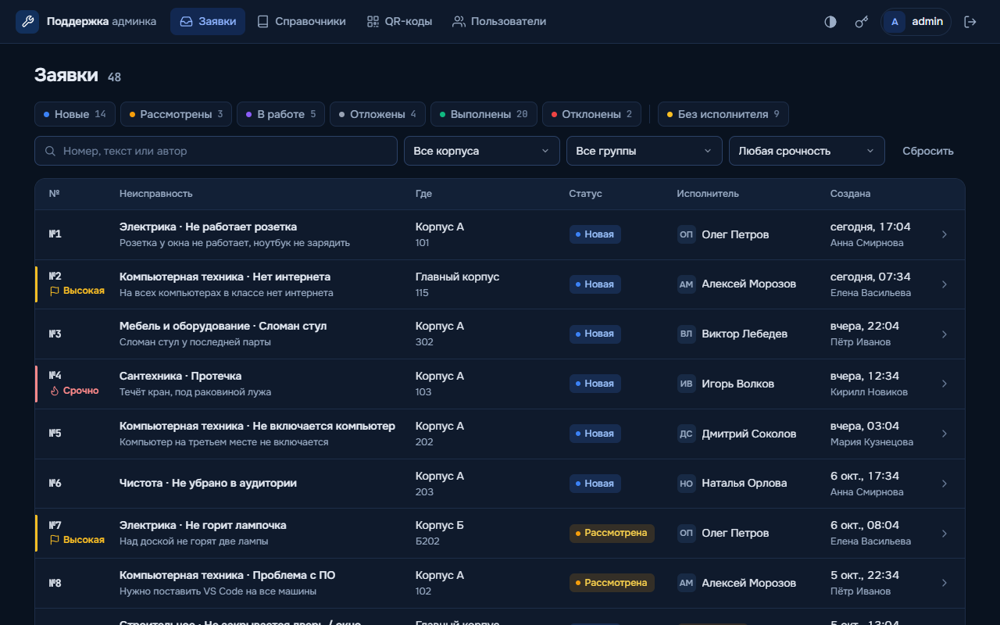
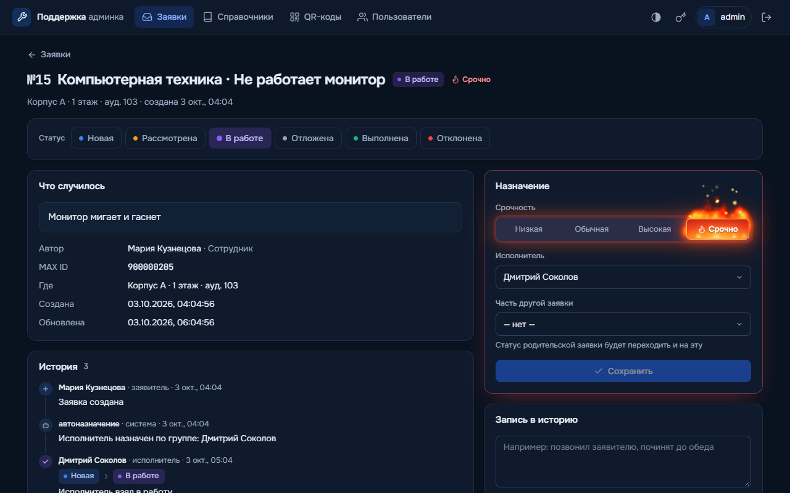
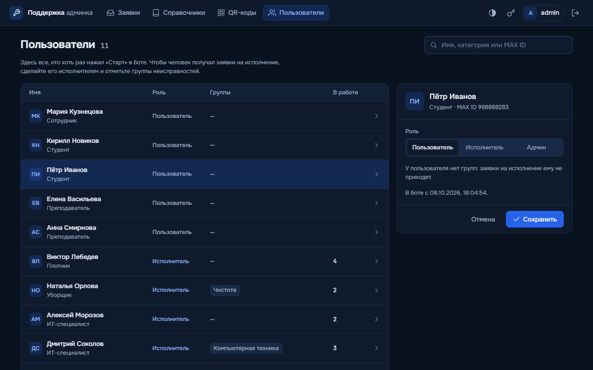
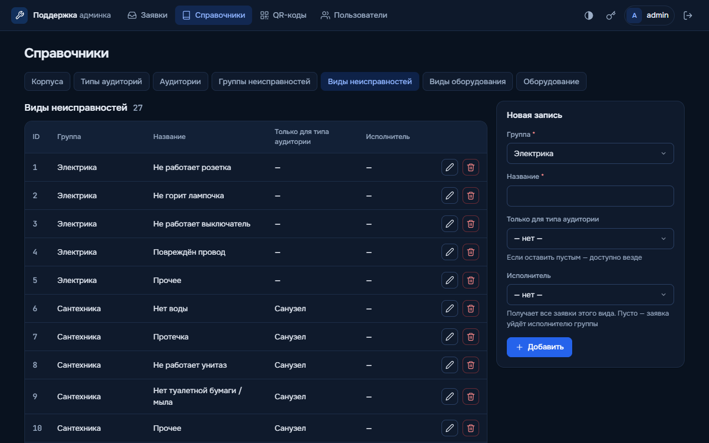
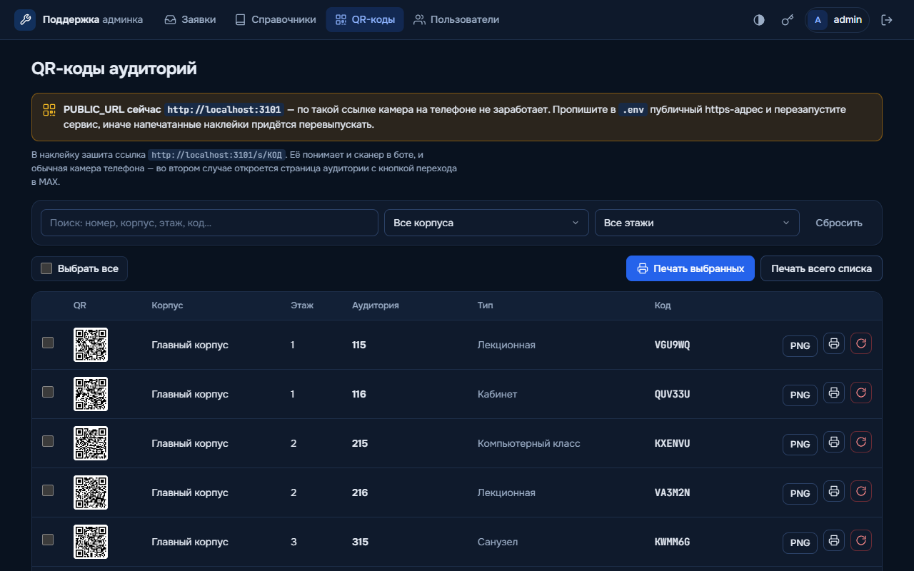
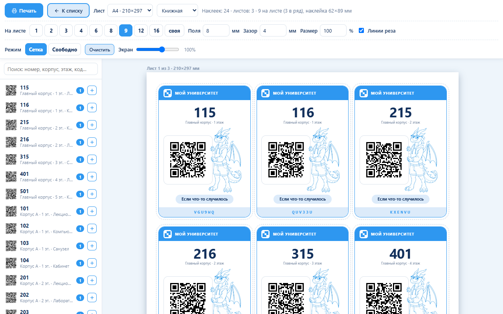
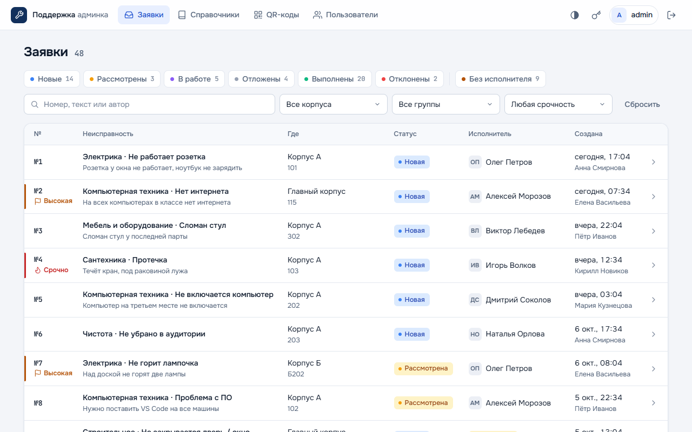
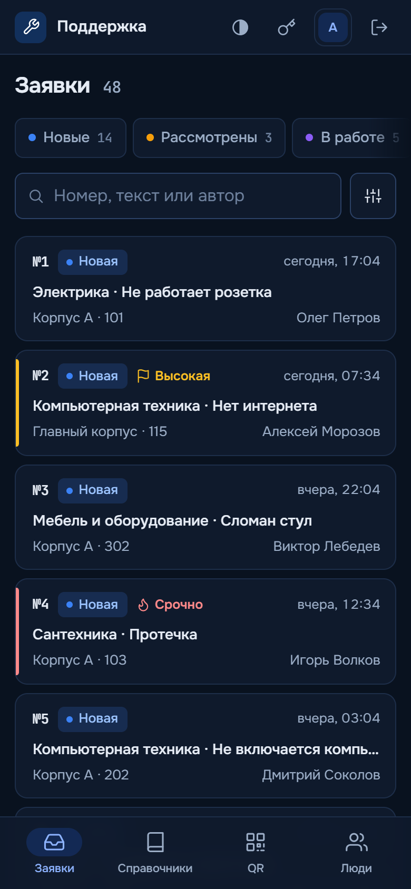

# Бот поддержки в MAX: заявки на ремонт аудиторий

Это мой дипломный проект. Идея простая: в университете постоянно что-то ломается
(розетка не работает, течёт кран, не включается компьютер в классе), а сообщить об этом
нормально некуда. Обычно пишут кому-то в личку, сообщение теряется, и никто не знает,
кто этим занимается.

Я сделал бота в мессенджере MAX, через которого любой студент или преподаватель за минуту
оставляет заявку, и веб-панель для администратора, где все заявки видно в одном месте.
Заявка сама уходит нужному исполнителю (электрику, сантехнику, айтишнику), а автор
получает уведомление, когда статус меняется.

На дверях аудиторий клеятся наклейки с QR-кодом. Человек сканирует код камерой телефона,
бот сразу знает корпус, этаж и номер аудитории, остаётся только выбрать, что сломалось.



## Содержание

- [Что умеет](#что-умеет)
- [Скриншоты](#скриншоты)
- [Стек](#стек)
- [Структура проекта](#структура-проекта)
- [Как запустить у себя](#как-запустить-у-себя)
- [Настройки .env](#настройки-env)
- [QR-наклейки и мини-приложение](#qr-наклейки-и-мини-приложение)
- [Как выбирается исполнитель](#как-выбирается-исполнитель)
- [База данных](#база-данных)
- [Деплой на сервер](#деплой-на-сервер)
- [Безопасность](#безопасность)
- [Грабли, на которые я наступил](#грабли-на-которые-я-наступил)
- [Что можно доделать](#что-можно-доделать)

## Что умеет

### Бот (для всех)

- При первом запуске спрашивает, кто ты: студент или сотрудник. Сотрудник выбирает
  специальность (преподаватель, электрик, сантехник, ИТ-специалист и т.д.). Если выбрать
  рабочую специальность, человек сразу становится исполнителем по своей группе неисправностей.
- Подача заявки по шагам: корпус -> этаж -> аудитория -> группа неисправности -> вид неисправности.
  Виды фильтруются по типу аудитории (например, "Протечка" есть только у санузлов).
- Перед отправкой показывается предпросмотр, можно добавить комментарий и фото.
- Кнопка "Сканировать QR": открывает сканер, и корпус с аудиторией подставляются сами.
- "Мои заявки": последние 20 заявок со статусами.
- Когда статус заявки меняется, автору приходит уведомление.

### Бот (для исполнителей)

- Новая заявка приходит в личку сразу с фото и кнопками.
- Кнопки: взять в работу, выполнено, выполнено с отчётом, сменить статус, отложить с причиной,
  написать администратору. Отчёт и причина сохраняются в историю заявки.
- "Заявки на исполнение": список всех своих незакрытых заявок.

### Веб-панель (для администратора)

- **Заявки.** Фильтры по статусам, "без исполнителя", корпусу, группе, срочности и поиск по
  номеру, тексту и автору. Фильтры применяются сразу, без кнопки "Применить". Список
  разбит на страницы по 25 заявок.
- **Карточка заявки.** Статус, срочность, исполнитель, привязка к другой заявке (если
  сломалось одно и то же, статус родительской заявки переходит и на дочерние), история
  всех действий, фото и запись в историю от админа. Всё сохраняется без перезагрузки страницы.
- **Справочники.** Корпуса, типы аудиторий, аудитории, группы и виды неисправностей,
  оборудование. У вида неисправности можно указать своего исполнителя.
- **QR-коды.** У каждой аудитории свой короткий код. Можно скачать PNG, перевыпустить код
  (старая наклейка перестанет работать) и собрать лист наклеек для печати: формат листа,
  сколько наклеек на листе, поля, линии реза, наклейки можно перетаскивать мышкой.
- **Пользователи.** Все, кто запускал бота. Тут назначается роль (пользователь,
  исполнитель, админ) и группы неисправностей исполнителя.
- Тёмная и светлая тема, нормальная вёрстка под телефон, плавные переходы между страницами.

## Скриншоты

| Карточка заявки | Пользователи |
|---|---|
|  |  |

| Справочники | QR-коды аудиторий |
|---|---|
|  |  |

| Печать наклеек | Светлая тема |
|---|---|
|  |  |

<p align="center"></p>

## Стек

- **Node.js 20+**, ES-модули
- **@maxhub/max-bot-api** - официальная библиотека для ботов MAX (long polling)
- **Express 5** + **EJS** - веб-панель, страницы рендерятся на сервере
- **PostgreSQL** + драйвер **pg**
- **express-session**, **bcryptjs** - вход в панель
- **qrcode** - генерация QR-кодов, **jsQR** - распознавание QR в браузере, где нет BarcodeDetector (iOS)
- Фронтенд без фреймворков: обычный JS и CSS. Переходы между страницами сделаны через
  View Transitions API, шрифты Onest и JetBrains Mono лежат в проекте (лицензия OFL)

## Структура проекта

```
├── index.js              точка входа: схема БД -> веб-панель -> бот
├── config.js             чтение настроек из .env
├── bot/
│   └── bot.js            весь бот: меню, подача заявки, кнопки исполнителя, уведомления
├── db/
│   ├── index.js          пул подключений к PostgreSQL
│   ├── schema.sql        схема базы (создаётся сама при запуске)
│   ├── seed.js           начальные справочники + учётка admin
│   ├── demo.js           демо-данные: люди, исполнители, заявки (npm run demo)
│   └── qr.js             коды аудиторий и токены сканера
├── web/
│   ├── server.js         Express: сессии, защита от CSRF, роуты
│   ├── routes/           заявки, справочники, пользователи, QR, сканер, вход
│   ├── views/            шаблоны EJS
│   └── public/           app.js, style.css, шрифты, картинки для наклеек
├── deploy/
│   ├── push.ps1          деплой с Windows: упаковать, залить по SSH, запустить установку
│   ├── setup-server.sh   установка на сервере (Ubuntu/Debian)
│   └── build-installer.sh  собрать установщик одним файлом
└── docs/screenshots/     скриншоты для этого README
```

## Как запустить у себя

### 1. Что нужно

- Node.js 20 или новее
- PostgreSQL 14 или новее
- Свой бот в MAX и его токен (как получить, написано ниже)

### 2. Создать базу

В `psql` от имени суперпользователя:

```sql
CREATE ROLE bot_support LOGIN PASSWORD 'bot_support';
CREATE DATABASE bot_support OWNER bot_support;
```

Таблицы создавать руками не надо, приложение само применяет `db/schema.sql` при запуске.

### 3. Скачать проект и поставить зависимости

```bash
git clone <ссылка на этот репозиторий>
cd <папка проекта>
npm install
```

### 4. Заполнить .env

```bash
cp .env.example .env
```

Дальше открыть `.env` и **вставить токен бота в `BOT_TOKEN`**. Без токена бот не запустится,
это сделано специально. Остальное для локального запуска можно оставить как есть.

**Где взять токен:** зайти на [business.max.ru](https://business.max.ru), раздел "Чат-боты",
создать бота (или выбрать своего), дальше "Настройки" и скопировать токен.
Токен никому не показывать и в git не коммитить: `.env` уже в `.gitignore`.

### 5. Залить демо-данные (по желанию)

```bash
npm run demo
```

Добавятся три корпуса, 24 аудитории, 6 исполнителей, 5 заявителей и 48 заявок в разных
статусах с историей. Так сразу видно, как выглядит рабочая панель. У демо-людей выдуманные
MAX ID, поэтому бот им ничего не отправит.

Если демо не нужно, этот шаг можно пропустить: справочники (корпуса, аудитории, группы
неисправностей) заполнятся и так при первом запуске.

### 6. Запустить

```bash
npm start
```

Панель откроется на http://localhost:3000.

**Пароль от панели.** При самом первом запуске (неважно, `npm start`, `npm run seed` или
`npm run demo`) создаётся учётка `admin` со случайным паролем, и он печатается в консоль
один раз, вот так:

```
✓ Создана учётка admin, пароль: xxxxxxxxxxxxxxxx. Смените его в панели (кнопка «Сменить пароль»)
```

Его надо сразу сменить в панели (кнопка с ключиком в шапке). Если пароль потерялся, проще
всего удалить строку из таблицы `admins` и перезапустить, создастся новый.

Бот работает через long polling, то есть сам ходит на сервер MAX за обновлениями, и
публичный адрес ему для этого не нужен. Можно открыть своего бота в MAX и нажать "Начать".

**Важно:** нельзя запускать две копии бота с одним токеном (например, на сервере и у себя
на компе). Они начнут забирать обновления друг у друга, и часть сообщений пропадёт.

## Настройки .env

| Переменная | Что это |
|---|---|
| `BOT_TOKEN` | токен бота MAX, обязателен |
| `PG_HOST`, `PG_PORT`, `PG_USER`, `PG_PASSWORD`, `PG_DB` | подключение к PostgreSQL |
| `PORT` | порт веб-панели, по умолчанию 3000 |
| `PUBLIC_URL` | публичный адрес панели. Из него собираются ссылки в QR-кодах. На сервере должен быть https |
| `MAX_MINIAPP` | `1`, если мини-приложение бота привязано к `PUBLIC_URL/scan` (см. ниже) |
| `BOT_LINK` | ссылка на бота, например `https://max.ru/my_support_bot` |
| `ORG_NAME` | подпись в шапке QR-наклейки |
| `SESSION_SECRET` | секрет для куки панели. На сервере свой: `openssl rand -hex 32` |
| `COOKIE_SECURE` | `1`, если панель открывается по https |

## QR-наклейки и мини-приложение

В QR-коде на наклейке зашита ссылка вида `PUBLIC_URL/s/КОД`, где КОД это 6 символов
(например `KTNFEF`). Буквы и цифры выбраны так, чтобы не путались: нет 0 и O, 1 и I.

Что происходит, когда человек сканирует наклейку обычной камерой телефона:

1. Открывается `PUBLIC_URL/s/КОД`, сервер находит аудиторию.
2. Сервер перенаправляет в MAX:
   - если `MAX_MINIAPP=1`: на `https://max.ru/<бот>?startapp=КОД`. Открывается мини-приложение
     бота (это страница `/scan`), оно получает код, проверяет подпись MAX и отправляет код
     на сервер. Бот пишет в чат "QR распознан" с корпусом и аудиторией, остаётся выбрать
     неисправность.
   - если `MAX_MINIAPP=0`: на `https://max.ru/<бот>?start=КОД`. Бот получает код в событии запуска.
3. Если `BOT_LINK` пустой, вместо перехода показывается страница аудитории с подсказкой.

Почему лучше мини-приложение, расписано в разделе [Грабли](#грабли-на-которые-я-наступил).

**Как включить мини-приложение:**

1. Панель должна открываться по https с постоянным адресом (свой домен или туннель).
2. На [business.max.ru](https://business.max.ru): Чат-боты -> ваш бот -> Расширенные настройки,
   указать ссылку на мини-приложение `https://ваш-домен/scan`.
3. В `.env` поставить `MAX_MINIAPP=1` и `BOT_LINK=https://max.ru/<имя бота>`.

Тогда кнопка "Сканировать QR" в боте открывает нативный сканер MAX. Без мини-приложения
бот даёт ссылку на страницу `/scan` в браузере, там сканер на камере (BarcodeDetector,
а на iOS через jsQR). Ссылку бот выдаёт конкретному человеку, живёт она 15 минут.

## Как выбирается исполнитель

Когда заявка создана, бот сам назначает исполнителя по такому порядку:

1. **Исполнитель вида неисправности** (Справочники -> Виды неисправностей). Если указан, заявка уходит ему.
2. Если у вида пусто, **исполнитель группы** (Пользователи -> группы исполнителя).
   Если в группе несколько человек, выбирается тот, у кого меньше незакрытых заявок.
3. Если нет ни там, ни там, заявка остаётся **новой без исполнителя**, и её распределяет админ.

Сначала у меня было наоборот (группа, потом вид), но на практике в группах всегда кто-то
стоит, и настройка у вида просто не срабатывала. Вид неисправности более точная настройка,
поэтому он главнее.

В демо-данных это видно: в группе "Компьютерная техника" стоит Дмитрий Соколов, но у вида
"Нет интернета" указан Алексей Морозов, поэтому такие заявки уходят Морозову.

В истории заявки записывается, почему выбран этот человек: "по виду неисправности" или "по группе".

## База данных

Схема в `db/schema.sql`, основные таблицы:

- `buildings`, `room_types`, `rooms` - корпуса, типы аудиторий и сами аудитории (у каждой свой `qr_code`)
- `fault_groups`, `fault_types` - группы и виды неисправностей (у вида может быть тип аудитории и свой исполнитель)
- `users` - все, кто писал боту (`max_id`, имя, роль: user / executor / admin)
- `executor_groups` - какие группы неисправностей закреплены за исполнителем
- `tickets` - заявки: где, что, статус, срочность, исполнитель, фото, родительская заявка
- `ticket_journal` - история по каждой заявке: кто, когда и что сделал
- `admins` - учётки веб-панели (пароли в bcrypt)
- `scan_tokens` - одноразовые ссылки на сканер
- `equipment_types`, `equipment` - оборудование в аудиториях

Статусы заявки: новая -> рассмотрена -> в работе -> выполнена, плюс отложена и отклонена.

Схема написана через `CREATE TABLE IF NOT EXISTS` и `ALTER TABLE ... ADD COLUMN IF NOT EXISTS`,
поэтому при обновлении ничего руками мигрировать не надо, новые колонки добавятся при запуске.

## Деплой на сервер

Я разворачивал на Ubuntu-сервере в локальной сети вуза. Скрипты рассчитаны на Ubuntu/Debian.

### Вариант 1: с Windows через push.ps1

1. В начале `deploy/push.ps1` указать `$Server` (пользователь@адрес), порт и ключ SSH, если нужен.
2. Запустить из папки проекта:

```powershell
powershell -ExecutionPolicy Bypass -File .\deploy\push.ps1
```

Скрипт упакует проект (без `node_modules` и `.env`), зальёт архив по SSH и запустит на
сервере `deploy/setup-server.sh`. Он попросит sudo-пароль, это нормально.

### Вариант 2: руками на сервере

Скопировать проект в `~/bot_support` и запустить:

```bash
bash deploy/setup-server.sh
```

### Что делает setup-server.sh

- ставит Node.js 20 и PostgreSQL, создаёт роль и базу `bot_support` (пароль генерируется
  один раз и лежит в `~/.bot_support_db_password`)
- прописывает подключение к базе в `.env`, спрашивает токен бота, если его там нет,
  генерирует `SESSION_SECRET` и ставит на `.env` права 600
- ставит зависимости через `npm ci`
- создаёт systemd-сервис `bot-support` с автозапуском
- если постоянного домена нет, поднимает бесплатный Cloudflare Quick Tunnel (сервис
  `bot-support-tunnel`) и прописывает его адрес в `PUBLIC_URL`

Скрипт можно запускать повторно, так и обновлять проект.

Ещё есть `deploy/build-installer.sh`: он собирает `deploy/install-on-server.sh`, это один
файл, внутри которого и код, и установка. Его можно просто закинуть на сервер и запустить.
В репозиторий он не попадает, собирается командой `bash deploy/build-installer.sh`.

### Полезные команды на сервере

```bash
sudo systemctl status bot-support       # статус
sudo journalctl -u bot-support -f       # логи
sudo systemctl restart bot-support      # перезапуск
```

Если панель смотрит в интернет через свой домен, удобно поставить nginx обратным прокси
на `127.0.0.1:3000`, а https повесить на nginx или на шлюз перед ним.

## Безопасность

- Токен бота, пароль базы и секрет сессий лежат только в `.env`, в коде их нет.
- Пароль админа при первом запуске случайный, хранится в bcrypt. Пароль можно сменить в
  панели, после смены остальные входы под этой учёткой завершаются.
- После 10 неудачных попыток входа за 15 минут с одного адреса каждая следующая попытка
  ждёт 3 секунды. Блокировать полностью не стал: за шлюзом вуза все могут быть с одного IP.
- Защита от CSRF: изменяющие запросы принимаются только со страниц самой панели
  (проверка заголовков `Sec-Fetch-Site` / `Origin`).
- Мини-приложение представляется подписанной строкой `initData`, сервер проверяет подпись
  по токену бота (HMAC-SHA256, как в документации MAX). Голому id пользователя сервер не верит.
- Ссылка на браузерный сканер привязана к человеку, которому её выдал бот, и живёт 15 минут.

## Грабли, на которые я наступил

Пишу сюда, потому что на это ушло больше всего времени, и документация MAX про это
говорит мало.

**1. Диплинк `?start=` работает только один раз.** Сначала наклейка вела на
`max.ru/<бот>?start=КОД`. Оказалось, событие `bot_started` с этим кодом MAX присылает,
только когда человек запускает бота впервые (или после остановки). Если чат с ботом уже
есть, ссылка просто открывает старую переписку, и бот кода не получает. На паре у
преподавателя это выглядело так: сканируешь аудиторию 302, а в чате висит 208 из прошлой заявки. Решение:
вести наклейку на мини-приложение через `?startapp=КОД`, оно открывается каждый раз.

**2. Фото не отображалось у исполнителя.** Бот пересылал исполнителю фото по токену из
входящего сообщения. MAX принимал запрос без ошибок, но картинка не показывалась.
Токен для отправки выдаёт только своя загрузка через `POST /uploads`, поэтому теперь бот
скачивает фото с CDN MAX и загружает его заново от своего имени. Полученный токен
сохраняется в `tickets.photo_upload_token`, чтобы не грузить одно фото дважды.

**3. Бот падал от любого сбоя сети.** В библиотеке `@maxhub/max-bot-api` 0.2.2 при обрыве
связи цикл опроса либо роняет весь процесс, либо молча останавливается. Сервис
перезапускался по кругу, а с ним терялись черновики заявок (сессии хранятся в памяти).
Теперь `index.js` сам перезапускает опрос с растущей паузой, и процесс не падает.

**4. Вложения из SDK.** Класс `ImageAttachment` в той же версии библиотеки сериализуется в JSON
без полей `type` и `payload` (у него метод `toJson`, а `JSON.stringify` ищет `toJSON`).
Поэтому вложения в коде собираются обычными объектами.

## Что можно доделать

- Хранить сессии бота и панели в PostgreSQL, а не в памяти. Сейчас при перезапуске
  теряется недозаполненная заявка, а `express-session` предупреждает про MemoryStore.
- Статистика в панели: сколько заявок по корпусам и группам, среднее время выполнения.
- Выгрузка заявок в Excel.
- Учёт оборудования по инвентарным номерам прямо из заявки.
- Тесты. Сейчас всё проверялось руками и скриптами на тестовой базе.
